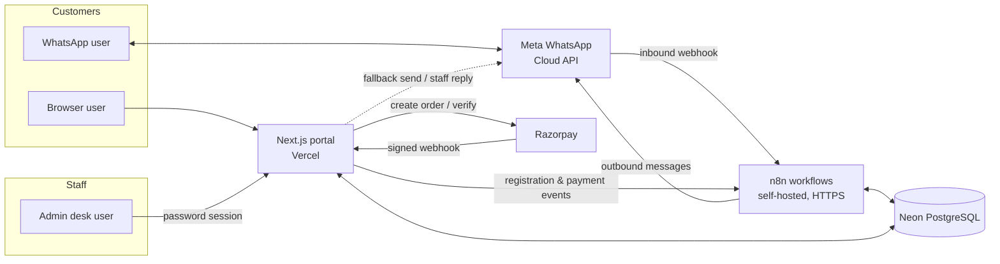
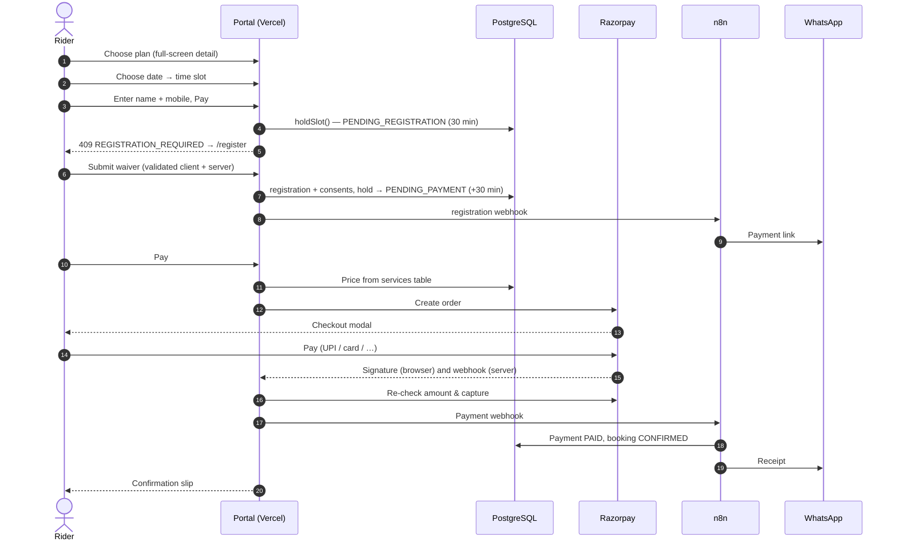
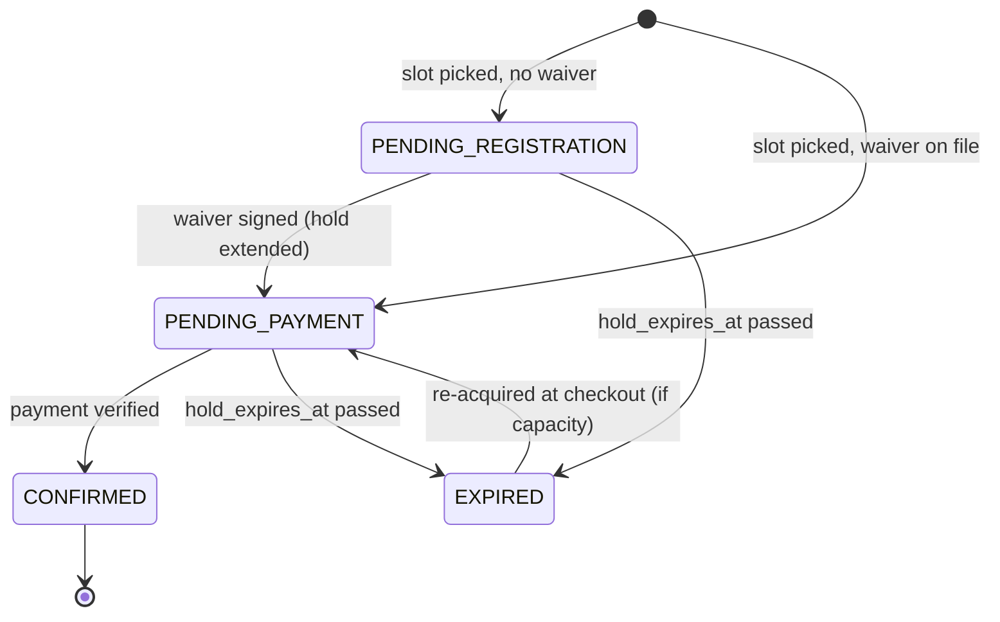
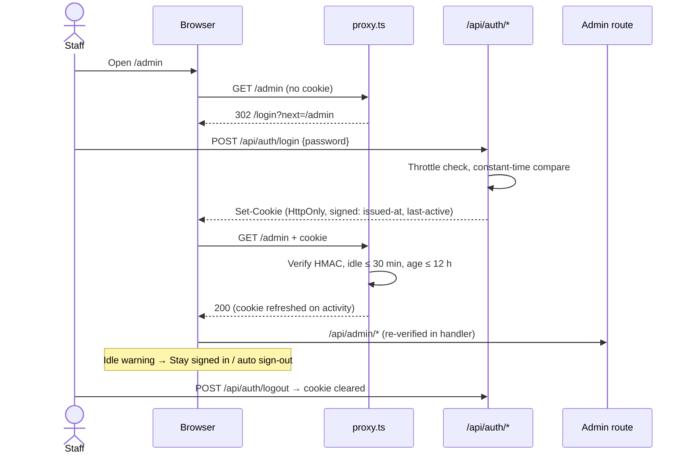
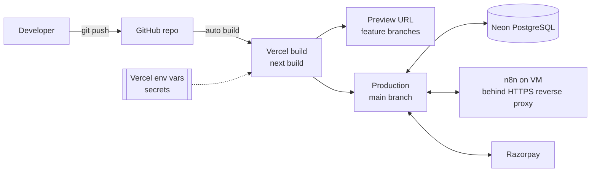

# Architecture

This document covers how the parts of the Gorai Equestrian Centre (GEC) booking platform connect, how a booking moves through the system, and how the platform is deployed. It contains no credentials or infrastructure addresses; `<placeholders>` stand in for real values.

---

## 1. System Context

| Component | Responsibility |
|---|---|
| **n8n** | Owns the WhatsApp conversation: menus, slot selection, AI answers, and every outgoing customer message. |
| **Next.js portal** | Web booking, waiver, payments, receipts, admin desk. |
| **Neon PostgreSQL** | The single source of truth for both channels, so web and WhatsApp can never double-book. |
| **Razorpay** | Payment collection. It sends signed callbacks and webhooks. |
| **Meta Cloud API** | Message transport. The portal calls it directly only when n8n fails, or when staff send a reply. |

---

## 2. Booking Sequence

If the waiver is already on file, steps 5–9 are skipped. Payment finalisation is **idempotent**: the browser callback and the Razorpay webhook can arrive in any order, and only one wins.

---

## 3. Slot Hold Lifecycle

- `time_slots.booked_count` counts `PENDING_*` and `CONFIRMED` rows. It changes only in the same statement that locks the slot row (`FOR UPDATE`), so two parallel requests cannot oversell a slot.
- Picking a new slot releases the order's previous unpaid hold in the same statement.
- A payment that arrives after its hold expired re-acquires the slot. If the slot is full, the booking is still recorded and passed to staff.

---

## 4. Admin Authentication & Session

| Rule | Value |
|---|---|
| Idle timeout | 30 minutes (background polling does not count as activity) |
| Absolute lifetime | 12 hours |
| Cookie | `HttpOnly`, `SameSite=Lax`, `Secure` in production |
| Revoke all sessions | Rotate `AUTH_SECRET` |
| Missing `ADMIN_PASSWORD` | Login disabled (fail closed) |

---

## 5. Deployment Workflow

| Step | Detail |
|---|---|
| Source | GitHub. `main` is the production branch. |
| Build | Vercel runs `next build` on each push. Other branches get preview URLs. |
| Secrets | Stored only in Vercel environment variables and local `.env.local`. |
| Database | Neon serverless Postgres. Apply SQL migrations from `../database/` before deploying code that needs them. |
| n8n | Self-hosted on a VM behind an HTTPS reverse proxy (`https://<your-n8n-host>`). Workflows are versioned as JSON in `../n8n-workflows/`. |
| Webhooks | Razorpay → `<app-url>/api/payments/webhook`. Meta → n8n ingress. |
| Rollback | Promote a previous deployment in the Vercel dashboard. |

---

## 6. Data Model (core tables)

| Table | Purpose |
|---|---|
| `customers` | One row per WhatsApp number |
| `conversations` / `messages` | Chat session state, control mode (AI / human), message log |
| `services` | Plan catalogue and authoritative prices |
| `selected_services` | An order: customer + plan + amount |
| `time_slots` | Bookable slots with capacity and `booked_count` |
| `slot_bookings` | Holds and confirmed bookings (state machine in §3) |
| `registrations` / `consents` | Rider waiver details and signed declarations |
| `payments` | One row per order. Gateway IDs, status, receipt number. |
| `knowledge_base` / `visual_assets` | Content for AI answers and media |
| `admin_audit` | Staff action trail |

Schema files: `../database/schema.sql`, `../n8n-workflows/GEC_workflow_schema_patch.sql`, and the dated migrations in `../database/`.

---

## 7. Design Decisions

- **One database, two channels.** WhatsApp (n8n) and the web portal use the same slot-locking SQL, so double booking is impossible across channels.
- **One sender per message.** n8n sends all customer messages. The portal sends directly only when n8n fails, which prevents duplicate receipts.
- **Server-side pricing.** The client never sends an amount. Price comes from `services`.
- **Two-path payment confirmation.** The browser signature check and the Razorpay webhook both finalise idempotently. A customer who closes the tab is still confirmed.
- **Shared validation.** `src/lib/validation.ts` is imported by the form and the API, so client and server rules can never drift.
- **Stateless sessions.** Signed cookies need no session store. Idle and absolute limits are encoded in the token and enforced in `proxy.ts` and in each admin handler.
- **Privacy by default.** Public endpoints expose no personal data. Booking lookups need the order ID and the phone number that owns it.
